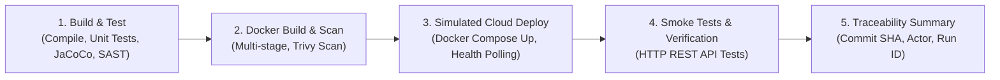

# Order Manager API — Evaluación Parcial 2 (DOY0101)

Este repositorio contiene la solución completa para la **Evaluación Parcial N°2 de Ingeniería DevOps (DOY0101)**, automatizando el ciclo de vida del microservicio **Order Manager** mediante contenedores, pruebas automatizadas, análisis de seguridad, orquestación y un pipeline CI/CD robusto implementado en GitHub Actions.

---

## 1. Arquitectura y Tecnologías

El microservicio gestiona pedidos de comercio electrónico con la siguiente pila tecnológica:

- **Lenguaje y Framework:** Java 17, Spring Boot 3.3.4 (Spring Data JPA, Spring Web, Validation, Actuator).
- **Gestión de Construcción:** Maven 3.9+ con plugin de cobertura JaCoCo y Sonar Scanner.
- **Bases de Datos:**
  - H2 Database (en memoria) para ejecución local rápida y suite de pruebas automatizadas.
  - PostgreSQL 16 (Alpine) para ejecución en contenedores y entorno productivo.
- **Contenerización:** Docker con Dockerfile multi-stage optimizado (Alpine Linux JRE) y usuario no-root.
- **Orquestación:** Docker Compose con control de dependencias basadas en healthchecks y límites de recursos.
- **Integración y Entrega Continua (CI/CD):** GitHub Actions (`.github/workflows/ci-cd.yml`).
- **Seguridad:** Dependabot (`.github/dependabot.yml`), escaneo SAST (SonarCloud/SonarQube) y análisis de vulnerabilidades en imágenes con Trivy.

---

## 2. Ejecución del Proyecto

### 2.1 Requisitos Previos
- Java 17 (JDK)
- Apache Maven 3.8+
- Docker Engine y Docker Compose v2+

### 2.2 Ejecución Local con Maven (H2 Database)
```bash
# Compilar y ejecutar pruebas
mvn clean test

# Iniciar la aplicación en puerto 8098
mvn spring-boot:run
```
La aplicación iniciará en `http://localhost:8098`.
- Consola H2: `http://localhost:8098/h2-console` (JDBC URL: `jdbc:h2:mem:orderdb`, Usuario: `sa`, Contraseña: vacía)
- Salud del microservicio: `http://localhost:8098/actuator/health`

---

## 3. Contenedores Docker (IE1 — 20%)

El microservicio se empaqueta utilizando un [`Dockerfile`](file:///Dockerfile) con las mejores prácticas de la industria:

1. **Construcción Multi-Stage:**
   - **Etapa de Construcción (`builder`):** Utiliza `maven:3.9.9-eclipse-temurin-17-alpine` para descargar dependencias y compilar el archivo JAR de manera reproducible.
   - **Etapa de Ejecución (`runtime`):** Utiliza `eclipse-temurin:17-jre-alpine`, reduciendo la superficie de ataque y el tamaño final de la imagen (~180MB).
2. **Seguridad y Principio de Menor Privilegio:** Se crea y asigna un usuario sin privilegios `appuser:appgroup` en lugar de ejecutar como root.
3. **Parámetros de Rendimiento:** Configuración de opciones JVM optimizadas (`-Xms256m -Xmx512m -XX:+UseG1GC`).
4. **Healthcheck Integrado:** Verificación periódica del estado del microservicio vía `wget` a `/actuator/health`.
5. **Contexto Limpio:** [`..dockerignore`](file:///.dockerignore) excluye archivos innecesarios (código fuente superfluo, binarios locales, documentación) para agilizar la transferencia y construcción.

### Comandos de Construcción y Ejecución Docker
```bash
# Construir la imagen Docker
docker build -t order-manager:latest .

# Ejecutar el contenedor en modo aislado
docker run -d -p 8098:8098 --name order-manager-app order-manager:latest

# Comprobar estado y logs
docker ps
docker logs -f order-manager-app
```

---

## 4. Pruebas Automatizadas (IE2 — 20%)

El proyecto cuenta con una batería completa de pruebas unitarias y de integración que validan los flujos críticos del negocio:

- **[`OrderServiceTest`](file:///src/test/java/com/example/ordermanager/service/OrderServiceTest.java):**
  - Creación de pedidos con y sin ítems.
  - Modificación de pedidos en estado `PENDING` y bloqueo de modificaciones en estados avanzados.
  - Máquina de estados finita: transiciones válidas (`PENDING` → `CONFIRMED` → `SHIPPED` → `DELIVERED`).
  - Validación de transiciones prohibidas (cancelar un pedido entregado, enviar un pedido pendiente, etc.).
  - Manejo de excepciones de negocio (`OrderNotFoundException`, `InvalidOrderStateException`).
  - Consultas y filtrado por estado (`getOrdersByStatus`).
- **[`OrderControllerTest`](file:///src/test/java/com/example/ordermanager/controller/OrderControllerTest.java):**
  - Validación de endpoints HTTP REST (códigos 200, 201, 204, 400 Bad Request, 404 Not Found, 409 Conflict).
  - Validación de payloads con Bean Validation (`@Valid`, validación de `customerName`, precios y cantidades).

### Ejecución de Pruebas y Cobertura
```bash
# Ejecutar todas las pruebas unitarias e integración
mvn clean test

# Generar reporte de cobertura JaCoCo
mvn jacoco:report
```
El reporte HTML de cobertura se genera en `target/site/jacoco/index.html`.
En el pipeline de GitHub Actions, cualquier fallo en una prueba interrumpe de forma inmediata la ejecución del flujo de integración continua, bloqueando el avance a las etapas de empaquetado y despliegue.

---

## 5. Seguridad y Escalabilidad (IE3 — 20%)

### 5.1 Dependabot (`.github/dependabot.yml`)
Configurado para monitorear semanalmente:
- Ecosistema **Maven** (`pom.xml`): Actualización de librerías, parches de seguridad y frameworks.
- Ecosistema **GitHub Actions** (`.github/workflows/`): Versiones actualizadas y seguras de las acciones utilizadas.

### 5.2 Análisis SAST (SonarQube / SonarCloud)
Configurado mediante [`sonar-project.properties`](file:///sonar-project.properties) y el plugin Maven oficial:
- Mapea código fuente (`src/main/java`), pruebas (`src/test/java`), binarios (`target/classes`) y reporte XML de JaCoCo.
- En el pipeline se ejecuta mediante autenticación segura con `SONAR_TOKEN`.
- Emite advertencias / bloqueos si no se superan los umbrales de calidad de código o si existen vulnerabilidades detectadas.

### 5.3 Escaneo de Vulnerabilidades de Imagen (Trivy)
En cada build, la acción de seguridad Aquasecurity Trivy escanea la imagen Docker construida, auditando tanto los paquetes del sistema operativo base (Alpine) como las librerías Java embebidas, alertando ante severidades `CRITICAL` y `HIGH`.

### 5.4 Parámetros de Escalabilidad y Gobernanza
- **Límites de recursos en Docker Compose:** CPU limitada a `1.0` y Memoria limitada a `512M` por servicio.
- **Políticas de reinicio:** `restart: unless-stopped` para alta disponibilidad ante fallos inesperados.
- **Aislamiento de red:** Red dedicada bridge `order-network` sin exposición indebida de puertos internos.
- **Gestión de Credenciales:** Parámetros configurables mediante variables de entorno (`DB_USER`, `DB_PASSWORD`), sin contraseñas en código duro.

---

## 6. Pipeline CI/CD y Despliegue Automatizado (IE4 — 20%)

El workflow oficial se ubica en [`.github/workflows/ci-cd.yml`](file:///.github/workflows/ci-cd.yml) y se dispara ante cualquier `push` o `pull_request` a la rama `main`, además de soportar ejecución manual (`workflow_dispatch`).



### Etapas del Pipeline:
1. **Compilación y Pruebas Automatizadas:** Configura JDK 17, compila con Maven y ejecuta las pruebas. Si una prueba falla, el pipeline se detiene inmediatamente.
2. **Análisis de Calidad y Seguridad:** Ejecución de JaCoCo y análisis SAST con SonarCloud (usando secretos de GitHub).
3. **Construcción y Escaneo de Imagen Docker:** Compila la imagen etiquetándola con el SHA del commit (`order-manager:${{ github.sha }}`) y escanea vulnerabilidades con Trivy.
4. **Despliegue Automatizado en Entorno Simulado:**
   - Levanta el stack completo con `docker compose up -d --build`.
   - Implementa un ciclo de espera activo (polling) contra `http://localhost:8098/actuator/health` hasta confirmar estado `UP`.
5. **Verificación Funcional (Smoke Tests):**
   - Prueba real de creación de pedido mediante `POST /api/orders`.
   - Consulta del pedido creado con `GET /api/orders/{id}`.
   - Confirmación del pedido mediante `PUT /api/orders/{id}/confirm`.
   - Listado de pedidos con `GET /api/orders`.
6. **Trazabilidad de Commits y Ejecuciones:**
   - Publica en `$GITHUB_STEP_SUMMARY` la metadata completa: Commit SHA, Autor, Número de ejecución, Workflow ID, Fecha UTC y Hash de la imagen Docker.

---

## 7. Orquestación con Docker Compose (IE5 — 20%)

El archivo [`docker-compose.yml`](file:///docker-compose.yml) orquesta la solución completa de microservicios:

| Servicio | Imagen | Puerto | Rol | Healthcheck |
|---|---|---|---|---|
| `db` | `postgres:16-alpine` | `5432:5432` | Persistencia relacional de pedidos | `pg_isready -U orderuser -d orderdb` |
| `app` | `order-manager:latest` | `8098:8098` | API REST Spring Boot | `wget -qO- /actuator/health` |

### Características de la Orquestación:
- **Secuenciamiento Condicional:** El servicio `app` depende estrictamente de que `db` alcance estado saludable (`condition: service_healthy`), evitando errores de conexión durante el arranque.
- **Persistencia de Datos:** Volumen persistente `postgres_data` montado en `/var/lib/postgresql/data`.
- **Segmentación de Red:** Red interna `order-network` tipo bridge.

### Comandos de Orquestación:
```bash
# Iniciar servicios en segundo plano con reconstrucción de imágenes
docker compose up -d --build

# Verificar estado de los contenedores y healthchecks
docker compose ps

# Visualizar logs en tiempo real
docker compose logs -f

# Probar endpoint de la API
curl -X GET http://localhost:8098/api/orders

# Detener servicios y liberar volúmenes
docker compose down -v
```

---

## 8. Configuraciones Requeridas en SonarCloud y GitHub Actions

Para la integración obligatoria de análisis SAST con SonarCloud (IE3):
1. **SonarQube Cloud:**
   - Asegurarse de que el proyecto (`MKbenjA9_Evaluaci-n2Devops`) pertenezca a la organización (`mkbenja9`).
   - Ir a **Administration > Analysis Method** y verificar que **Automatic Analysis** esté desactivado (**OFF**), seleccionando **GitHub Actions**.
   - Generar un token de análisis en la cuenta de SonarCloud.
2. **GitHub Secrets:**
   - Ir a **Settings > Secrets and variables > Actions** en el repositorio de GitHub.
   - Añadir el secreto `SONAR_TOKEN` con el token generado desde SonarCloud.
   *(Nota: El pipeline requiere obligatoriamente `SONAR_TOKEN` y evalúa el Quality Gate; si el análisis falla o no supera el umbral de calidad, el pipeline detiene de inmediato el despliegue).*

---

## 9. Declaración de Uso de Inteligencia Artificial (IA)

En cumplimiento de las normativas éticas y formativas de la asignatura:

- **Herramientas utilizadas:** Asistente de IA (Antigravity IDE / Gemini).
- **Alcance y aplicación:** Apoyo en auditoría técnica de dependencias, estructuración de archivos de configuración estándar (Dockerfile, docker-compose.yml, dependabot.yml, workflows de GitHub Actions) y redacción técnica de la documentación de arquitectura.
- **Validación:** Todas las configuraciones, scripts y pruebas fueron auditados y verificados técnicamente sobre los requisitos oficiales de la Evaluación Parcial 2.

> [!IMPORTANT]
> ### Reflexiones Personales y Conclusiones Individuales (Sin IA)
> Conforme a la pauta oficial (*"Cada integrante debe incluir en la sección de conclusiones una reflexión personal, redactada sin apoyo de IA, explicando su aprendizaje y contribución al proyecto"*), este apartado queda reservado para la redacción manual de cada estudiante:
> 
### Reflexión Personal — Benjamin Jerez
> ""

### Reflexión Personal — Dylan Monroy
> "Al trabajar en este encargo me di cuenta de lo mucho que la automatización nos evita errores tontos en el día a día. Pasar de correr los tests y armar los contenedores a mano a tener un pipeline que se encarga de todo ,Desde probar el código hasta empaquetar con Docker Compose.te da otra seguridad antes de subir cambios. Me sirvió bastante aprender a rastrear cada versión con el hash de Git y ver cómo el trabajo en equipo con las ramas y las alertas de Dependabot ayudan a que el proyecto no se vuelva un caos. En resumen, entendí que DevOps no es solo meter herramientas, sino armar un flujo ordenado y estable para que las cosas no se rompan en el camino."

### Reflexión Personal — Nicolas Silva
> ""